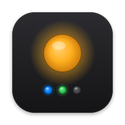
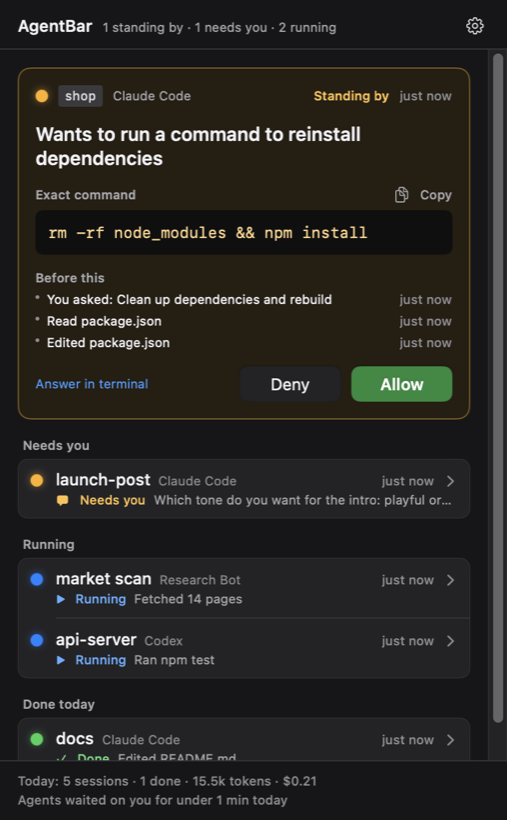
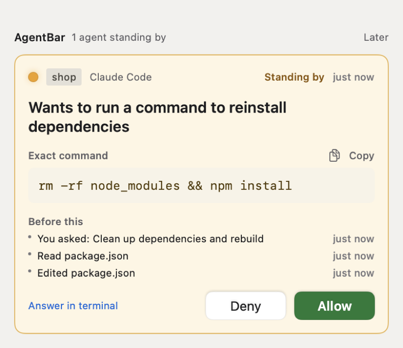
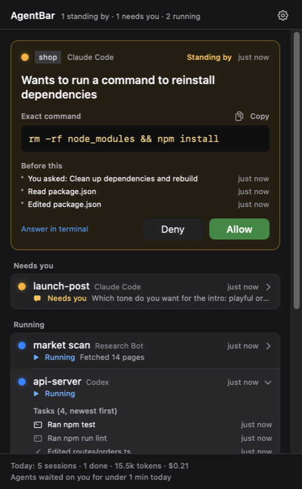
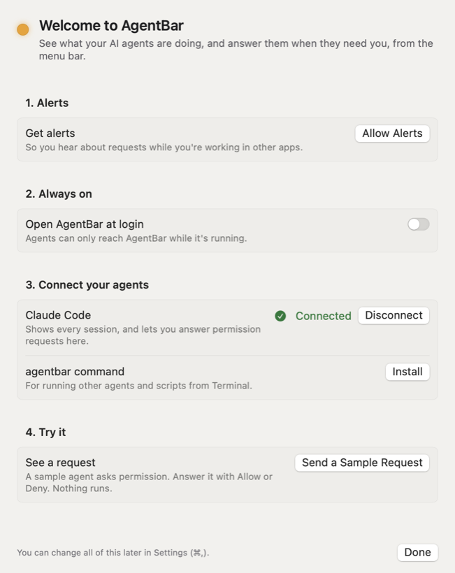
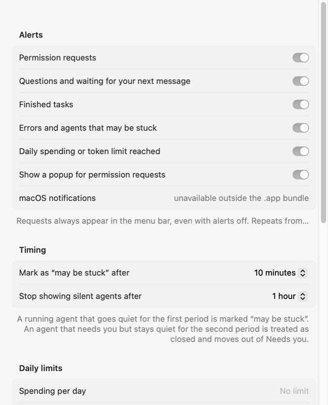

<p align="center">
  
</p>

<h1 align="center">AgentBar</h1>

<p align="center">
  A macOS menu bar app that shows what your AI agents are doing,<br>
  and lets you answer them, with <b>Allow</b> or <b>Deny</b>, the moment they need you.
</p>

<p align="center">
  <a href="https://github.com/ololadetobi/Agent-Monitor/releases/latest">Download</a> ·
  <a href="#getting-started">Getting started</a> ·
  <a href="agentbar/docs/adapters.md">Connect agents</a> ·
  <a href="SECURITY.md">Security</a> ·
  <a href="agentbar/CHANGELOG.md">Changelog</a>
</p>

<p align="center">
  
  &nbsp;
  
</p>

---

## Why

AI agents stop and wait: for a permission, an answer, a review. When you run several at once, in terminals, editors and background jobs, you only notice a blocked agent when you happen to look. AgentBar puts every agent in one place in the menu bar and taps you on the shoulder only when one needs you.

## Features

- **One glance:** a lamp in the menu bar shows whether anything needs you, with a count.
- **Answer permission requests where you are.** Each request says what the agent wants in plain words, shows the **exact command**, and lists what it did just before. Then: **Allow**, **Deny**, or **Answer in terminal**, from the panel, a floating popup, or the notification.
- **Every agent, grouped by what it needs from you:** Needs you, Running, Done today. Click an agent to see its tasks (the last 20) and details.
- **Notices problems:** a running agent that goes quiet is marked *may be stuck*; one that needs you but stays silent for an hour is retired automatically. Errors alert you.
- **Today at a glance:** sessions, tasks done, how long agents waited on you, tokens and cost (when the agent reports them), with optional daily limits.
- **Works with your agents:** one-click connections for **Claude Code, Cursor, Gemini CLI and Antigravity**, `agentbar run -- <command>` for anything else, and a small local protocol for your own tools.
- **Native and private:** built in SwiftUI, follows light/dark mode, VoiceOver and Reduce Motion; everything stays on your Mac.

<p align="center">
  
</p>

## Requirements

macOS 13 Ventura or later, on Apple silicon or Intel.

## Install

1. Download **`AgentBar-<version>.dmg`** from [Releases](https://github.com/ololadetobi/Agent-Monitor/releases/latest).
   Optionally check it: `shasum -a 256 AgentBar-*.dmg` should match `SHA256SUMS.txt` from the same release.
2. Open the `.dmg` and drag **AgentBar** to **Applications**.
3. **Approve it once.** AgentBar is signed but not notarized by Apple, so macOS blocks the first open:
   - **macOS 13–14:** in Applications, Control-click AgentBar → **Open** → **Open**.
   - **macOS 15 and later:** double-click AgentBar (it's blocked) → **System Settings → Privacy & Security** → **Open Anyway**.

## Getting started

On first launch a short **setup guide** opens:

<p align="center"></p>

1. **Allow alerts** so you hear about requests while you work in other apps.
2. **Open at login**: agents can only reach AgentBar while it's running.
3. **Connect your agents:** click **Connect** next to each one you use. AgentBar adds its hooks to that tool's settings file, keeps your other settings, and saves a backup. Restart open sessions afterwards.

   | | Sessions and tasks | Knows it's waiting for you | Allow / Deny in AgentBar |
   |---|---|---|---|
   | Claude Code | ✅ | ✅ | ✅ |
   | Cursor | ✅ | — | ✅ terminal commands (opt-in) |
   | Gemini CLI | ✅ | ✅ | — (answer in Gemini) |
   | Antigravity | ✅ | — | ✅ terminal commands (opt-in) |

   - **Anything else:** click **Install** for the `agentbar` command, then run your agent or script through it:
     ```bash
     agentbar run -- npm run build
     agentbar run --agent trainer --title "model v2" -- python train.py
     ```
4. **Send a sample request** to see a permission card. Nothing runs.

Reopen the guide any time from the panel's **⚙︎ → Setup Guide…**; everything else is in **⚙︎ → Settings…** (⌘,).

### From Terminal

```bash
agentbar status            # what AgentBar is showing right now
agentbar status --json     # the same, for scripts
agentbar run -- <command>  # report any command: running, then done or failed
```

## How permission requests work

When a connected agent asks permission (Claude Code always; Cursor and Antigravity for terminal commands once you turn it on), it **waits** while AgentBar shows the request:

| You choose | The agent gets |
|---|---|
| **Allow** | Permission for exactly this one action |
| **Deny** | A refusal ("The user denied this from AgentBar.") |
| **Answer in terminal** | Nothing from AgentBar; it asks in its own window as usual |
| *(no answer in time, or AgentBar isn't running)* | Same as *Answer in terminal* (5 minutes for Claude Code, 60 seconds for Cursor and Antigravity) |

Nothing is ever approved without your click. Notifications offer **Allow** only when the whole command fits in the banner, and only with your Mac unlocked. Longer commands show **Review…** instead.

## Privacy & security

- **Local only.** No network listener and no servers: agents talk to AgentBar through a socket in `~/Library/Application Support/AgentBar` that only your macOS user can open (enforced by file permissions and a peer user-ID check).
- **What's stored:** sessions, their recent tasks and status messages (which can include the start of your prompts to Claude), and daily totals, in a local SQLite file readable only by you. Kept 30 days by default (7/30/90 in Settings); **⚙︎ → Clear History** removes everything.
- **What's never stored or sent:** your files, full transcripts, or anything off your Mac.
- Agent text is always shown as plain text, links that open other apps ask first, and request cards can't be altered after they appear.

Details, threat model and how to report a problem: **[SECURITY.md](SECURITY.md)**.

## Settings

<p align="center"></p>

Alerts per type (permission, questions, finished, errors and stuck, daily limits), the request popup, *may be stuck* timer (5–60 min), silence timer (30 min–8 h), daily spending and token limits, history length, open at login, and agent connections.

## Building from source

Needs Xcode 15+ or the Command Line Tools (`xcode-select --install`).

```bash
cd agentbar
swift build                                   # debug build
swift run agentbar-selftest                   # tests (200+ checks)
python3 -m venv .build-tools && .build-tools/bin/pip install dmgbuild==1.6.2   # once, for the designed .dmg window
scripts/build-dmg.sh                          # universal app + .dmg in dist/, runs the release tests first
```

The app is ad-hoc signed; no Apple Developer account is needed. More detail: [agentbar/README.md](agentbar/README.md).

## Project layout

| Path | What's there |
|---|---|
| `agentbar/Sources/AgentBarCore` | Event schema and validation, session engine, SQLite history, local socket server |
| `agentbar/Sources/AgentBarApp` | SwiftUI menu bar app: panel, request popup, settings, setup guide |
| `agentbar/Sources/AgentBarCLI` | The `agentbar` command (`run`, `status`, `emit`, `hook claude`) |
| `agentbar/Sources/AgentBarSelfTest` | Test runner |
| `agentbar/adapters` | Claude Code hook snippet; bash, Python and Node examples |
| `agentbar/docs` | [Event schema](agentbar/docs/event-schema.md), [connecting agents](agentbar/docs/adapters.md), [release checklist](agentbar/docs/release-checklist.md) |
| `agentbar/DESIGN.md` | The "Standby, Go" design system |
| `AgentBar-PRD.md`, `AgentBar-Implementation-Plan.md` | Product requirements and the build plan with results per milestone |

## Releasing

Update `agentbar/VERSION`, add an entry to `agentbar/CHANGELOG.md`, commit, then push a matching tag:

```bash
git tag v1.0.1 && git push origin v1.0.1
```

GitHub Actions builds the universal app, runs the tests, and publishes the `.dmg` and checksums with the changelog entry as release notes.

## Contributing

See [CONTRIBUTING.md](CONTRIBUTING.md).

## License

No license has been chosen yet, so all rights are reserved by the author. Ask before reusing the code.
